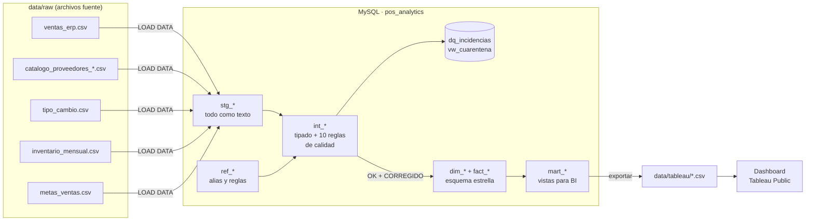
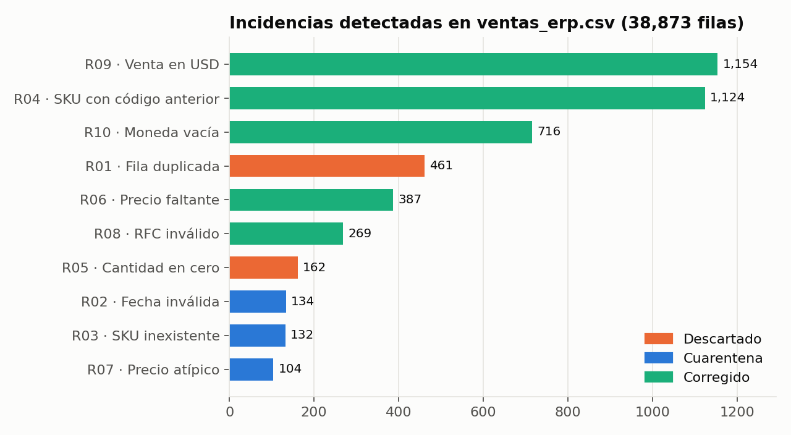
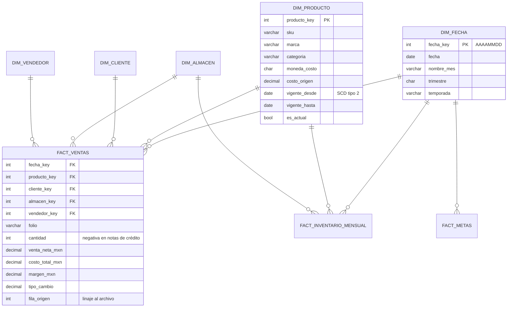
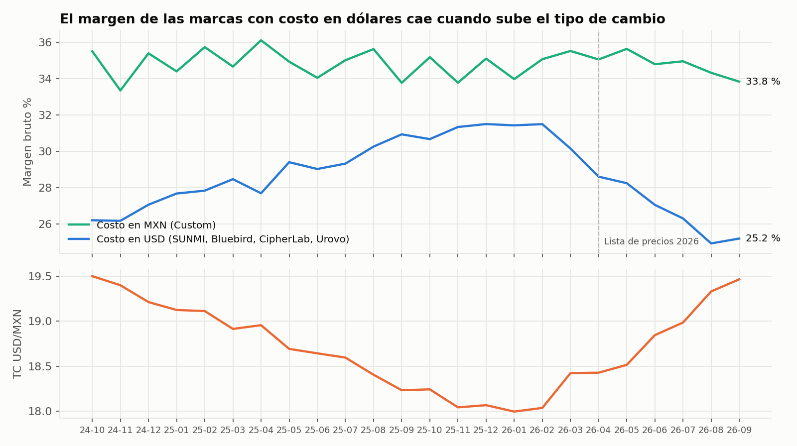

# pos-sales-analytics

[](https://github.com/carlosadr1314-debug/pos-sales-analytics/actions/workflows/ci.yml)


Pipeline **ETL en SQL** y **data warehouse con esquema estrella** para analizar las ventas de un distribuidor de hardware POS. Parte de archivos "sucios" tal como salen de un ERP y de listas de precios de proveedores, y termina en un **dashboard de Tableau** y un reporte de hallazgos con recomendaciones.

> 📊 **Dashboard:** *(agrega aquí el enlace de Tableau Public; ver [tableau/GUIA_DASHBOARD.md](tableau/GUIA_DASHBOARD.md))*
> 📄 **Hallazgos:** [docs/insights.md](docs/insights.md)

Es el proyecto hermano de [pos-catalog-db](https://github.com/carlosadr1314-debug/pos-catalog-db): aquel diseña la base **transaccional**, este construye la capa **analítica**.

---

## El problema

Los datos reales nunca llegan limpios. Los archivos de origen de este proyecto traen los problemas típicos:

| Problema | Ejemplo en los archivos |
|---|---|
| Fechas en 3 formatos, algunas imposibles | `2026-03-05`, `05/03/2026`, `5-mar-2026`, `31/02/2026` |
| Montos como texto | `$5,900.00`, `5,900.00`, `" 5900 "`, `N/D` |
| Descuentos inconsistentes | `10%`, `0.10`, `10`, vacío |
| El mismo estado escrito de 6 formas | `Ciudad de México`, `CDMX`, `D.F.`, `Distrito Federal`… |
| SKU con códigos anteriores, minúsculas o inexistentes | `SUNMI-V2S`, `sun-v2s`, `GENERICO` |
| RFC mal capturados | `abc-910718-c29`, `SIN RFC`, vacío |
| Ventas en dólares mezcladas con ventas en pesos | `USD`, `Dólares`, `MXN`, `M.N.`, vacío |
| Filas duplicadas por doble exportación | 461 filas idénticas |
| Lista de proveedor exportada de Excel en Windows | `;` como separador, coma decimal (`329,50`), Windows-1252, CRLF |
| Categorías de cada proveedor en su propio idioma | `Desktop POS`, `COMPUTADORA MOVIL`, `Stampanti POS` |

## La solución



| Etapa | Archivo | Qué hace |
|---|---|---|
| Extract | [`etl/01_staging.sql`](etl/01_staging.sql) | Carga cada archivo **tal cual** (todo `VARCHAR`), con su número de línea para rastrear cualquier dato hasta su origen |
| Referencias | [`etl/02_referencias.sql`](etl/02_referencias.sql) | Tablas de alias (estados, almacenes, monedas, categorías) y el catálogo de reglas de calidad |
| Funciones | [`etl/03_funciones.sql`](etl/03_funciones.sql) | `fn_parse_fecha`, `fn_limpiar_monto`, `fn_parse_descuento`, `fn_rfc_valido`… Devuelven `NULL` en vez de adivinar |
| Transform | [`etl/04_limpieza_calidad.sql`](etl/04_limpieza_calidad.sql) | Tipado, normalización, 10 reglas de calidad, bitácora de incidencias, cuarentena y tipo de cambio con relleno para fines de semana |
| Load | [`etl/05_modelo_estrella.sql`](etl/05_modelo_estrella.sql) | 5 dimensiones (producto como **SCD tipo 2**) y 3 tablas de hechos |
| Consumo | [`etl/06_marts.sql`](etl/06_marts.sql) | 7 vistas planas listas para Tableau |

### Reglas de calidad

Ninguna fila desaparece sin dejar rastro. Cada una termina en uno de cuatro estados:

| Regla | Detecta | Acción |
|---|---|---|
| R01 | Fila duplicada exacta | **Descartada** |
| R05 | Cantidad en cero | **Descartada** |
| R02 | Fecha vacía o imposible | **Cuarentena** |
| R03 | SKU que no existe ni tiene equivalencia | **Cuarentena** |
| R07 | Precio < 50 % o > 200 % del de lista | **Cuarentena** |
| R04 | SKU con código anterior | Corregida (tabla de equivalencias) |
| R06 | Precio faltante | Corregida (precio de lista vigente a la fecha) |
| R08 | RFC inválido | Corregida (asignada a *Público en general*, `XAXX010101000`) |
| R09 | Venta en USD | Corregida (convertida con el TC del día) |
| R10 | Moneda vacía | Corregida (se asume MXN) |



**Resultado:** de 38,873 filas, 88.1 % entran tal cual, 9.4 % se corrigen automáticamente, 1.6 % se descartan y 0.95 % quedan en cuarentena para que negocio las revise (`vw_cuarentena`).

---

## Modelo dimensional



**¿Por qué la dimensión de producto es SCD tipo 2?** En abril de 2026 cambió la lista de precios del proveedor. Si solo se guardara el costo actual, el margen de 2025 se recalcularía con los costos de 2026 y **la caída de margen desaparecería del análisis**. Con SCD 2 cada venta se valúa con el costo vigente en su fecha.

---

## Hallazgos principales



1. **La venta crece 22.7 %** (2026 vs. 2025, mismo periodo), pero el margen baja un punto.
2. **El tipo de cambio se come el margen** de las marcas importadas: pasó de 31.5 % a 25.2 %, mientras las de costo en pesos se mantienen en ~34 %. SUNMI subió su costo 8 % y el precio solo 4 %.
3. **Bluebird va al 82 % de su meta** de 2026.
4. **$6 M inmovilizados:** Urovo en Monterrey tiene 301 días de inventario, contra ~50 del resto.
5. **Un vendedor concede 9.8 % de descuento** contra 3.6 % del equipo (≈ $6.2 M en dos años).
6. **El URV-DT40 se devuelve 4.3 %**, 2.4 veces más que el siguiente producto.

Detalle, tablas y recomendaciones: **[docs/insights.md](docs/insights.md)**

> Los datos son **sintéticos**, generados con semilla fija. Los patrones se plantaron en el generador para que el análisis tuviera algo real que encontrar. Los modelos de producto son reales; precios, clientes, vendedores y tipo de cambio son ficticios.

---

## Cómo ejecutarlo

**Requisitos:** MySQL 8.0 y el cliente `mysql` (o solo Docker).

```bash
git clone https://github.com/carlosadr1314-debug/pos-sales-analytics.git
cd pos-sales-analytics

# Opción A: con MySQL instalado
export MYSQL_HOST=127.0.0.1 MYSQL_USER=root MYSQL_PWD=tu_contraseña
./etl/run_etl.sh        # ~15 s: carga, limpia, modela y exporta a data/tableau/
./tests/run_tests.sh    # 48 pruebas

# Opción B: con Docker
docker compose up -d mysql
docker compose run --rm etl
```

Salida del ETL:

```
▶ etl/01_staging.sql              ok (0s)
▶ etl/02_referencias.sql          ok (0s)
▶ etl/03_funciones.sql            ok (0s)
▶ etl/04_limpieza_calidad.sql     ok (8s)
▶ etl/05_modelo_estrella.sql      ok (3s)
▶ etl/06_marts.sql                ok (0s)

Reconciliación de ventas_erp.csv:
+--------------+-------+-------+
| estado_carga | filas | pct   |
+--------------+-------+-------+
| OK           | 34230 | 88.06 |
| CORREGIDO    |  3650 |  9.39 |
| DESCARTADO   |   623 |  1.60 |
| CUARENTENA   |   370 |  0.95 |
+--------------+-------+-------+
```

Para regenerar los datos fuente (opcional, ya vienen en el repo): `python3 tools/generar_datos.py` (solo usa la biblioteca estándar).

---

## Pruebas

48 pruebas en [`tests/validaciones.sql`](tests/validaciones.sql):

| Suite | Qué garantiza |
|---|---|
| **Reconciliación** (8) | Ninguna fila se pierde: staging = tipadas = hechos + descartadas + cuarentena; los totales de los marts cuadran con los hechos |
| **Calidad** (13) | Cada regla detecta **exactamente** los defectos que inyectó el generador (`_esperado_calidad.csv`) |
| **Modelo** (10) | SCD 2 sin traslapes y una sola versión actual por SKU; cada venta usa el costo de su fecha; calendario continuo; margen = venta − costo |
| **Funciones** (17) | Pruebas unitarias: `31/02/2026` → NULL, `29/02/2024` válido, `$5,900.00` → 5900, `0.10` → 10 %… |

El workflow de GitHub Actions además verifica que:

- el generador produce **exactamente** los mismos archivos (semilla fija);
- los CSV de Tableau del repo coinciden con los que produce el ETL;
- correr el ETL **dos veces** da el mismo resultado (idempotencia).

---

## Estructura

```
pos-sales-analytics/
├── data/
│   ├── raw/                 # archivos fuente "sucios" (entrada)
│   └── tableau/             # marts exportados (salida → Tableau)
├── etl/
│   ├── 01_staging.sql … 06_marts.sql
│   ├── run_etl.sh           # orquesta todo el pipeline
│   └── exportar_tableau.sh
├── analysis/analisis.sql    # 10 preguntas de negocio
├── tests/                   # 48 pruebas + runner
├── tableau/GUIA_DASHBOARD.md
├── docs/
│   ├── insights.md          # hallazgos y recomendaciones
│   └── img/
├── tools/
│   ├── generar_datos.py     # generador de datos sintéticos (stdlib)
│   └── graficas_preview.py  # gráficas del README (matplotlib)
├── docker-compose.yml
└── .github/workflows/ci.yml
```

## Qué demuestra este proyecto

| Habilidad | Evidencia |
|---|---|
| ETL con SQL | `LOAD DATA`, staging → integración → modelo, carga completa e idempotente |
| Limpieza y validación de datos | 10 reglas con bitácora, cuarentena y conteos verificados |
| Modelado dimensional | Esquema estrella, SCD tipo 2, dimensión de fechas, tablas de hechos de transacción y de foto mensual |
| SQL avanzado | CTE recursivos, funciones de ventana (`LEAD`, `ROW_NUMBER`, `FIRST_VALUE`, relleno *gaps & islands*), `LATERAL`, funciones propias |
| Análisis de negocio | Crecimiento, estacionalidad, margen vs. tipo de cambio, metas, Pareto, rotación de inventario y devoluciones |
| BI | Marts para Tableau y guía de dashboard con KPIs y campos calculados |
| Calidad de software | 48 pruebas, CI con verificación de determinismo e idempotencia |

## Próximos pasos

- [ ] Publicar el dashboard en Tableau Public y agregar la captura
- [ ] Carga incremental (solo archivos nuevos) en lugar de recarga completa
- [ ] Orquestar el pipeline con n8n y avisar por Telegram si alguna regla de calidad supera un umbral

---

**Carlos Adrián García Rodríguez** · Ingeniería en Sistemas Computacionales, UVM
[LinkedIn](https://linkedin.com/in/carlos-garcia-rodriguez-593436272) · [GitHub](https://github.com/carlosadr1314-debug)
