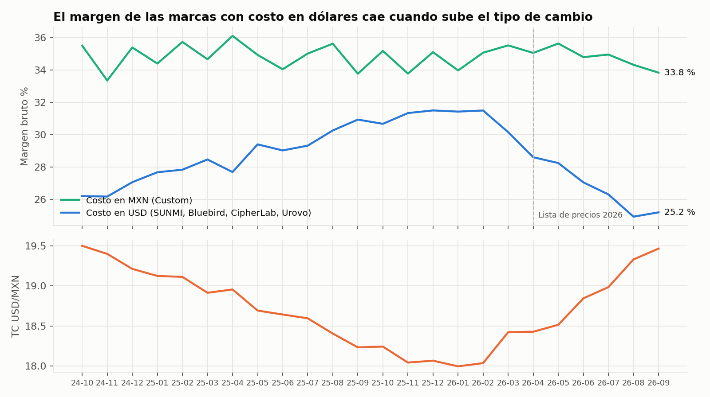
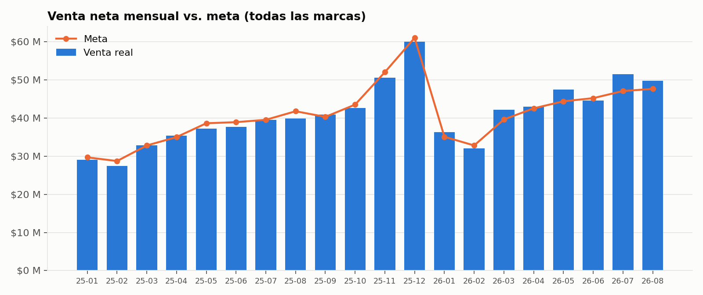
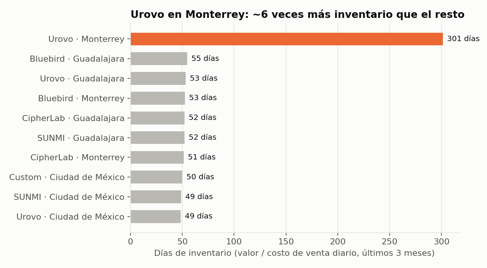
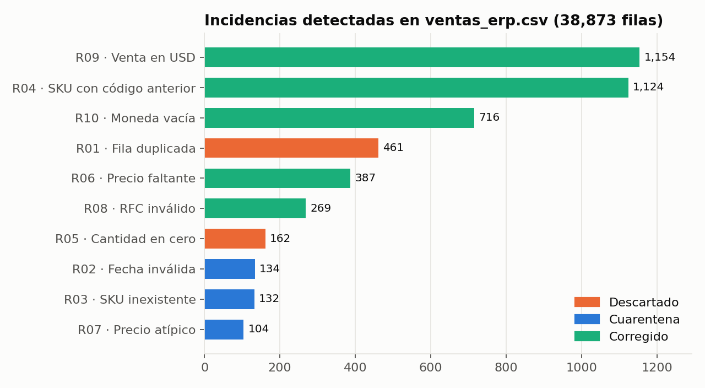

# Hallazgos del análisis

> **Contexto:** los datos son **sintéticos**. Los genera `tools/generar_datos.py`, y en el generador se *plantaron* a propósito varios patrones de negocio. El objetivo del proyecto es demostrar que el pipeline y el análisis los **detectan y los cuantifican** partiendo de archivos sucios. Las cifras vienen de [`analysis/analisis.sql`](../analysis/analisis.sql) y cubren del 1-oct-2024 al 26-sep-2026.

## Resumen para dirección

| # | Hallazgo | Cifra clave | Acción sugerida |
|---|---|---|---|
| 1 | El negocio crece a buen ritmo | **+22.7 %** en venta (2026 vs. 2025, mismo periodo) | Mantener; vigilar margen |
| 2 | El tipo de cambio se está comiendo el margen de las marcas importadas | Margen de marcas con costo en USD: **31.5 % → 25.2 %** | Revisar la lista de precios de SUNMI y Bluebird; evaluar coberturas cambiarias |
| 3 | Bluebird no alcanza su meta | **82 %** de avance en 2026 | Plan comercial específico o ajustar la meta |
| 4 | Hay $6 M inmovilizados en inventario de Urovo en Monterrey | **301 días** de inventario vs. ~50 del resto | Frenar compras y redistribuir a CDMX/GDL |
| 5 | Un vendedor da el triple de descuento | **9.8 %** vs. 3.6 % del equipo (≈ $6.2 M cedidos) | Política de descuentos con autorización |
| 6 | Un producto se devuelve 2-4 veces más que el resto | URV-DT40: **4.3 %** de unidades devueltas | Levantar RMA con el fabricante y revisar la causa |

---

## 1. Crecimiento y estacionalidad

| Periodo (1-ene al 26-sep) | Venta neta | Margen | Facturas |
|---|---:|---:|---:|
| 2025 | $315.8 M | 30.0 % | 5,809 |
| 2026 | $387.6 M | 29.0 % | 7,087 |
| **Variación** | **+22.7 %** | **−1.0 pp** | **+22.0 %** |

El crecimiento viene de **más transacciones** (+22 % en facturas), no de un ticket más alto. La venta crece, pero el margen baja un punto (ver hallazgo 2).

**Estacionalidad (2025, índice sobre el promedio mensual):** enero 0.74 y febrero 0.70 son los meses más bajos, mientras que noviembre (1.28) y diciembre (1.52) son los picos. El índice también incluye la tendencia de crecimiento del año, así que exagera un poco el cierre. Aun así, el patrón es claro: **Q4 concentra la demanda**. Las compras a proveedor deben colocarse desde septiembre.

## 2. El tipo de cambio y la lista de precios 2026 erosionan el margen

- Las marcas con costo en **pesos** (Custom) mantienen un margen estable de **34-35 %** durante los dos años.
- Las marcas con costo en **dólares** siguen al tipo de cambio en sentido inverso:
  - Con el peso fuerte (TC ≈ 18.0, dic-25 a feb-26), su margen llegó a **31.5 %**.
  - Con el TC en 19.47 (sep-26), cayó a **25.2 %**.
- En abril de 2026 entró la nueva lista de precios. **SUNMI subió su costo en USD 8 %, pero nosotros solo subimos el precio de lista 4 %.** Su margen pasó de **28.9 % a 22.8 %** (ene-mar vs. abr-sep 2026). Bluebird tuvo el mismo efecto, de 31.6 % a 27.3 %.

**Recomendación:** indexar el precio de lista de las marcas importadas al tipo de cambio, o revisarlo cada mes, y trasladar completo el aumento de costo del proveedor.

> Nota de diseño: gracias a la **dimensión de producto tipo SCD 2**, cada venta se valúa con el costo vigente en su fecha. Si solo se guardara el costo actual, el margen de 2025 se recalcularía con los costos de 2026 y la caída no se vería.

## 3. Venta vs. meta

| Marca (ene-ago 2026) | Real | Meta | Avance |
|---|---:|---:|---:|
| Bluebird | $35.5 M | $43.1 M | **82.4 %** |
| Urovo | $35.2 M | $36.9 M | 95.3 % |
| Custom | $54.1 M | $51.6 M | 104.9 % |
| CipherLab | $69.9 M | $66.4 M | 105.3 % |
| SUNMI | $152.4 M | $136.6 M | 111.6 % |

En total la empresa va por arriba de la meta, pero **Bluebird se quedó 18 puntos abajo** todo el año. No es un mes malo, es una tendencia.

## 4. Inventario inmovilizado

A agosto de 2026, **Urovo en Monterrey tiene 301 días de inventario ($7.2 M)**. El resto de las combinaciones marca-almacén está entre 49 y 55 días. Llevarlo a 50 días liberaría **cerca de $6 M de capital de trabajo**. El problema fue creciendo mes a mes durante 2026, lo que indica compras que no se ajustaron a la demanda de la región.

## 5. Descuentos por vendedor

| Vendedor | Descuento ponderado | Margen | Venta |
|---|---:|---:|---:|
| Rodrigo Salas | **9.8 %** | **25.2 %** | $90.1 M |
| Resto del equipo | 3.5 – 3.7 % | 29.8 – 30.1 % | — |

Con el descuento promedio del equipo, Rodrigo habría cedido **$3.6 M en lugar de $9.8 M**, es decir, ≈ **$6.2 M** más de lo normal en dos años. Conviene revisar si esos descuentos compraron volumen o fidelidad (se puede comparar su recompra contra la del resto) antes de tomar una decisión.

## 6. Devoluciones

| SKU | Unidades vendidas | Devueltas | Tasa |
|---|---:|---:|---:|
| **URV-DT40** | 4,674 | 201 | **4.3 %** |
| CL-RK95 | 447 | 8 | 1.8 % |
| URV-SR5600 | 2,213 | 35 | 1.6 % |

El URV-DT40 se devuelve **2.4 veces más** que el siguiente producto. Es un candidato para revisar la calidad con el fabricante, además de impactar el inventario de Urovo (hallazgo 4).

## 7. Clientes y categorías

- **Concentración:** el 20 % de los clientes (180 de 899) genera el **72 %** de la venta, y 280 clientes suman el 80 %. Es un patrón de Pareto clásico: perder a un cliente grande pesa mucho.
- **Categorías (últimos 12 meses):**

| Categoría | Venta | Participación | Margen |
|---|---:|---:|---:|
| Computadoras móviles | $178.8 M | 32.8 % | 29.6 % |
| Impresoras | $120.5 M | 22.1 % | 36.1 % |
| Terminales POS | $112.2 M | 20.6 % | 24.5 % |
| RFID | $61.8 M | 11.3 % | 32.4 % |
| Kioscos | $42.1 M | 7.7 % | **15.3 %** |
| Lectores de código de barras | $29.6 M | 5.4 % | **40.2 %** |

Los **lectores** tienen el mejor margen pero la menor participación, así que son una oportunidad de venta cruzada en cada pedido de terminales. Los **kioscos** venden tickets altos con margen bajo, lo que conviene vigilar si crecen en la mezcla.

## 8. Calidad de los datos de origen

De 38,873 filas del ERP:

| Estado | Filas | % |
|---|---:|---:|
| OK | 34,230 | 88.06 % |
| Corregido automáticamente | 3,650 | 9.39 % |
| Descartado (duplicados y cantidad 0) | 623 | 1.60 % |
| En cuarentena para revisión | 370 | 0.95 % |

Las 104 filas con **precio atípico** estaban 10 veces arriba o abajo del precio de lista, casi seguro por errores de captura. Cargarlas habría distorsionado la venta de esos días. Por eso van a cuarentena y no se descartan: alguien de negocio debe confirmarlas.
